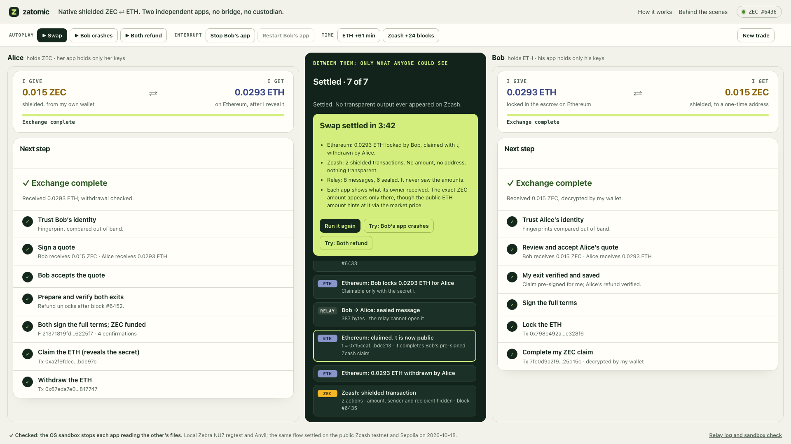

# Zatomic

**Atomic swaps of shielded ZEC for ETH, with both exits prepared before funding.**

[Live demo](https://162-55-186-88.sslip.io) · [Public testnet runs](#public-testnet-runs) · [Protocol in one page](docs/protocol.md)



Zatomic swaps native shielded ZEC for ETH between two parties who have already
agreed a trade. There is no bridge, no wrapped ZEC and no custodian or solver.

Unlike ordinary FROST, combining Alice's and Bob's partial signatures here gives
an adaptor pre-signature, not a valid spend signature. When Alice reveals the
secret t to claim the ETH, Bob adds it to complete the RedPallas signature and
claims the shielded ZEC without further help from Alice.

## The problem

Alice has ZEC and wants ETH; Bob has ETH and wants ZEC. Whoever pays first can be
cheated, so the two payments must be linked. Bitcoin-style swaps use hash and time
locks in scripts, but a shielded Zcash note has no scripts: it moves only with a
valid signature from its key. Other routes avoid this by proving Zcash history to
Ethereum, routing through solvers and public viewing keys, or using transparent ZEC.

## The idea: one secret, two exits


- **FROST, joint custody.** Alice funds a shielded note whose spend key is a
  fresh 2-of-2 FROST key, so neither side can spend it alone.
- **Adaptor signature, Bob claims alone.** Before Alice funds the note, both
  sign Bob's claim C with their nonce point shifted by T = t·G, R̂ = R + T, so
  their partial signatures add up to a pre-signature one secret short:
  ŝ·G = R̂ − T + c·X′. Bob checks it himself, without knowing t
  ([how the two signers compute ŝ](docs/protocol.md#how-the-pre-signature-is-computed)).
- **Escrow on Ethereum.** Bob locks ETH to T. Alice claims it with t; the escrow
  checks t·G = T on Pallas, and the same t completes Bob's signature:
  s = ŝ + t gives s·G = R̂ + c·X′. After locking, Bob needs nothing more from Alice.
- **Lock time, Alice refunds alone.** Before funding, both also fully sign
  Alice's refund R. Zcash enforces a lock time only when a transaction has a
  transparent input with a non-final sequence number, so Alice prepares a private
  transaction A that turns a little of her own shielded change into a small
  transparent coin, and R spends that coin. If nobody reveals t, Bob takes his ETH
  back after the deadline, and after the Zcash deadline Alice sends A, then R, and
  recovers her ZEC without Bob. A settled swap sends neither A nor R.
- **Signed before the note exists.** v6 transactions keep the anchor and proofs
  outside what spend signatures sign
  ([ZIP 229](https://github.com/zcash/zips/blob/929a92f7383e036b6f6a48f43ec88c5bdd130003/zips/zip-0229.md#anchor-commitment-version-6)),
  so C and R are signed first and proved once the note is mined.

The [protocol in one page](docs/protocol.md) explains each step.

## How it compares

Each existing route is good at its own job; a private trade between two parties
who have already agreed a price pays for it.

- **SPV, light-client and ZK bridges** let Ethereum verify Zcash payments, which
  supports general cross-chain apps, but Ethereum must follow Zcash consensus. In
  Skyhook's September 2026 testnet swap
  ([post](https://forum.zcashcommunity.com/t/we-just-did-a-fully-trustless-shielded-zec-to-evm-atomic-swap-with-no-new-signing-primitives-and-yes-it-is-programmable/57827)),
  the Ethereum order carried the Zcash recipient's address and the contract
  checked a Zcash txid it predicted from the proposal; hiding them is planned
  with ZK proofs, which adds proving circuits and an on-chain verifier
  ([proposal](https://forum.zcashcommunity.com/t/skyhook-and-esmaste-cross-chain-bridging-messaging-and-execution-layer/58167)).
- **NEAR Intents** has competing solvers, many assets and automatic liquidity,
  and is live. It accepts shielded ZEC and can pay ZEC out to an Orchard
  receiver ([LI.FI docs](https://docs.li.fi/introduction/zcash-ecosystem)), but
  settlement runs through solvers and bridge contracts, and the cited Zcash
  bridge contract funds that payout from a transparent input and checks it with
  an all-zero outgoing viewing key, so anyone can see the amount and recover the
  recipient ([code](https://github.com/Near-One/btc-bridge/blob/0b02818d47/contracts/satoshi-bridge/src/zcash_utils/orchard_policy.rs#L11-L13)).
- **THORChain** integrated native ZEC in October 2026, with pool-based,
  market-priced swaps and no wrapped ZEC, but its ZEC integration uses
  transparent Zcash transactions, so addresses, amounts and vault movements are
  public ([THORChain](https://blog.thorchain.org/bringing-native-zcash-to-thorchain)).

Zatomic needs no solver, pool or bridge, and asks Ethereum to verify no Zcash
history: the escrow checks one Pallas relation, t·G = T. A settled swap's two
Zcash transactions have no transparent input or output and no outgoing viewing
key, so only each recipient's own key decrypts its output. The trade-offs: no
price discovery (it settles a price both parties already agreed), ZEC ⇄ ETH
only, and each side watches until its deadline.

## Live demo

https://162-55-186-88.sslip.io runs Alice's and Bob's apps as separate
processes, each holding only its own keys, on private test chains (Zebra
regtest and Anvil): a swap, a crash right after the claim, or a refund, about two
minutes each. Between the apps pass only pinned-TLS signing and a relay that sees
two identity manifests and six sealed envelopes, never the amounts or the
funding transaction. One visitor drives at a time; others watch the same trade.
To run it yourself, see [the demo guide](docs/demo.md).

## Public testnet runs

Zcash public testnet (Ironwood) and Sepolia, 0.001 test ZEC for 0.001 Sepolia ETH:

| Date | Escrow | Outcome | Record |
|---|---|---|---|
| 2026-10-21 | V2 (shipped) | Settled; Zcash saw two fully shielded transactions | [record](evidence/2026-10-21-public-testnet-v2.json) |
| 2026-10-21 | V2 (shipped) | Nobody revealed t; both sides refunded | same record |
| 2026-10-20 | V1 | Nobody revealed t; both sides refunded | [record](evidence/2026-10-20-public-testnet-refund.json) |
| 2026-10-18 | V1 | Settled | [record](evidence/2026-10-18-public-testnet-swap.json) |

On Sepolia the V2 escrow used 295,236 gas for a settled swap (lock, claim,
withdraw) and 215,713 for a refund, against 1,420,389 and 974,494 for V1. It
checks t·G = T with a width-4 fixed-base comb table and keeps each order in one
hashed storage slot; its one-time deployment costs more (7.1M gas against 5.1M).
See the [gas benchmarks](docs/gas-optimization.md).

## Run it

Prerequisites: Rust 1.93, Python 3.11+, Node/npm, Foundry 1.3.1 and Docker. The
pinned node bootstrap supports Apple Silicon and Linux ARM64.

```sh
make doctor
make demo        # one browser app at http://127.0.0.1:8787
make two-party   # separate apps for Alice and Bob; stage at http://127.0.0.1:8790/stage
make verify      # Rust checks, contract tests and the timing model
```

More: [the demo guide](docs/demo.md) and [command-line reproduction](docs/reproduce.md).

## Docs

**Understand it**

- [Protocol](docs/protocol.md): the transactions, components, deadlines,
  recovery cases and what is tested
- [Security](docs/security.md): reviews, the adaptor signing calculation and
  open risks
- [Privacy](docs/privacy.md): what each observer sees
- [Evidence](docs/evidence-index.md): every recorded run, public and local
- [Escrow gas](docs/gas-optimization.md) and the
  [V2 escrow review](docs/escrow-v2-review.md)

**Run it**

- [Demo](docs/demo.md): the two-party apps and stage, locally or on a server
- [Reproduce](docs/reproduce.md): command-line chain tests and pinned
  dependencies
- [Public testnet runbook](docs/public-execution.md): how the funded public runs
  were executed

Slides used in the demo video: [PDF](docs/zatomic-slides.pdf).

## Limits

- A settled swap is fully shielded on Zcash. A refund adds one small transparent
  coin, created from Alice's own change, because Zcash enforces a lock time only
  when a transaction has a transparent input with a non-final sequence number.
  The ETH side is public.
- Both owners have run on one host; independently administered hosts are not
  demonstrated.
- The adaptor extension and the Solidity Pallas check are unaudited, and mainnet
  is unsupported.
- Each side must watch its deadline, and inclusion and reorgs must stay within
  the timing window.
- The public runs read chain data from third-party RPC providers, not from our
  own verifying nodes.
- Private keys, notes and journals stay in ignored `.local` directories.

MIT licensed; upstream components keep their own licenses
([pinned dependencies](docs/reproduce.md#pinned-dependencies-and-licenses)).
