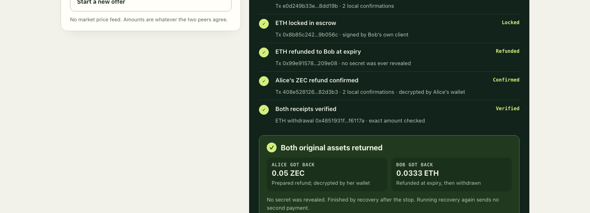

# Latch

**P2P OTC swaps of shielded ZEC for ETH, with recovery prepared before funding.**



Latch is an independent ZECATHON Cross-chain prototype. Two participants prepare
native shielded claim and refund transactions using a custom RedPallas adaptor
signature. A scalar revealed to an immutable ETH escrow completes the Zcash
claim. No Zcash receiver, viewing key or note opening goes into the EVM claim.
Alice sets the amounts, Bob accepts the signed quote, and both authorize the
complete exchange after checking their recovery paths. ZEC stays on Zcash and
ETH stays on Ethereum; Latch exchanges ownership without minting wrapped assets.

The local demo runs **real Zebra NU7 and Anvil transactions**. It includes a
successful exchange, interruption after secret reveal, and interruption before
reveal. Recovery resumes from durable state; replay checks produce no second
payment. This is a working isolated-chain prototype, not a public-testnet release
or an audited protocol.

[Previous local-release walkthrough](docs/demo/latch-2min.mp4) — recorded before
the browser OTC update; waits omitted. The user will produce the final video.

[Fresh-checkout verification](evidence/2026-10-15-clean-reproduction.json) rebuilt
`9b978e3` and completed exchange/refund/replay with new wallets and node state.
The local release is complete.

**Public testnet swap (2026-10-18):** a funded exchange of 0.001 test ZEC for
0.001 Sepolia ETH settled on the public networks: escrow deployment, shielded
funding F, ETH lock, ETH claim (revealing t), Bob's shielded ZEC claim C and
Alice's withdrawal. Bob's wallet decrypted his 0.001 ZEC; F and C have no
transparent input or output, and the refund auxiliary was never broadcast.
[Record with transaction links](evidence/2026-10-18-public-testnet-swap.json).
Both owners ran on one host; observations trust public RPC providers.
The [execution checklist](docs/public-execution.md) connects deployment,
owner preparation, both senders, monitoring and final verification.

## Run

Prerequisites: Rust 1.93, Python 3.11+, Node/npm, Foundry 1.3.1 and running Docker.
The pinned node bootstrap currently supports Apple Silicon / Linux ARM64.

```sh
make doctor
make demo
```

Open **http://127.0.0.1:8787**. Enter exact amounts and click **Sign quote as
Alice**. Bob reviews the signed terms (amounts, price, fees, ETH recipient) and
clicks **Accept as Bob**. **Authorize and fund** then prepares both exits, collects
both owners' full-term signatures and funds. The demo creates disposable local
test funds (up to 1 ZEC / 10 ETH per quote). Pick a demo outcome to stop after
or before the reveal, then use **Restart and recover**. A run takes about two and
a half minutes here, mostly proving. Setup uses pinned dependencies and an
isolated, ownership-labeled node. It never touches another project's wallet or
chain.

For peer-selected amounts, use the [OTC offer/accept CLI](docs/otc-offers.md).
It supports exact decimal amounts and signed quotes between separately pinned
operators. The browser uses that same canonical implementation. No market-price
feed or counterparty matching is implemented.

A separate [read-only public-testnet wallet](docs/public-testnet.md) downloads
Ironwood compact blocks, decrypts locally and resumes persisted note witnesses.
Public synchronization has been exercised with an unfunded wallet. The public
sender entry points ran the funded success path on 2026-10-18; the public
refund path has not run.

**Two-party mode:** `make two-party` gives Alice and Bob separate apps (ports
8791 and 8792). Each holds only its own keys, and the OS sandbox denies it the
other's files. A third page plays the chains and a relay that sees only identities
and sealed envelopes. See
[two-party mode](docs/two-party.md).

If already built and the node is running:

```sh
python3 scripts/demo_server.py
```

## Inspect the work

- [Start here: evidence by guarantee level](docs/evidence-index.md)
- [What each observer can see (privacy)](docs/privacy.md)
- [Two-party mode: separate sandboxed apps for Alice and Bob](docs/two-party.md)
- [Second review (2026-10-17): fixed adaptor share-release flaw, UI redesign, re-verification](docs/review-2026-10-17.md)
- [Submission draft](docs/submission.md) and [two-minute presentation](docs/demo-walkthrough.md#two-minute-presentation)
- [Reproduction and CLI gates](docs/reproduce.md)
- [Protocol, assumptions and recovery graph](docs/protocol.md)
- [Architecture and secret/authority boundaries](docs/architecture.md)
- [Focused security review, cryptographic cross-check and deployment blockers](docs/security.md)
- [Skyhook comparison and intended differentiation](docs/competitive-position.md)
- [Judge walkthrough](docs/demo-walkthrough.md)
- [Public-network readiness](docs/public-testnet.md) and [dependencies](docs/dependencies.md)
- [Authenticated signer channel and its limits](docs/signer-transport.md)
- [Participant-owned recovery data and funding-order safeguards](docs/recovery-bundles.md)
- [Owner-held ETH clients, restart and competing-relayer gates](docs/owner-clients.md)
- [Owner-operated native exits without coordinator files or ETH signing keys](docs/owner-native-recovery.md)
- [Separate operator CLI and OS-isolated setup/settlement](docs/independent-operators.md)
- [Alice-created OTC quotes and Bob's signed acceptance](docs/otc-offers.md)
- [Both owners sign the cross-chain offer before ZEC funding](docs/funding-consent.md)
- [Cancel interrupted setup or recover a committed source release](docs/setup-recovery.md)
- [SIGKILL recovery, peer-directory journals and owned worker cleanup](docs/process-recovery.md)
- [Controlled EVM forks, receipt replay and changed relayers](docs/evm-reorg.md)
- [Withdrawal recovery when forks change the owner's nonce](docs/withdrawal-recovery.md)
- [Native confirmation loss and replacement-branch exit recovery](docs/native-reorg.md)
- [Published funding recovery after secret exposure and its limits](docs/funding-reorg.md)
- [Older funding anchors with current spendability](docs/funding-anchor.md)
- [Current status](STATUS.md) and [remaining work](TASKS.md)
- [Public evidence](evidence/): native/EVM compatibility, chain acceptance,
  interrupted claim/refund recovery, signer nonce replay and tampering tests

`make verify` runs Rust checks, contract tests and the bounded timing model.
The chain gates and UI have their own reproduction commands; a signature test
alone is not presented as a successful swap.

## Boundaries

The exchanged ZEC remains shielded. A settled swap is fully shielded on Zcash.
A refund additionally uses an Alice-owned transparent auxiliary coin to make the
native timelock effective; Alice creates it from her own change only when she
refunds, so it is public only then. ETH-side activity is public.

Both signers run in separate processes on one host. New browser runs use pinned
mutual TLS for native preparation and separate owner-held ETH keys and journals.
Both owners sign the full cross-chain offer before source funding is authorized;
their identity pins are provisioned locally and are not remote identity discovery.
A durable source decision precedes signing. Unreleased setup can be permanently
cancelled; committed funding follows the prepared recovery path.
The node cannot sign for those owners; the coordinator does not read Alice's
unrevealed scalar. Browser recovery restarts the same owner clients. Older saved
runs retain their original recovery driver. Independent-host wallet operation
is not demonstrated. A separate operator gate enforces private-root file access
denials on the same host; this is not a hardened machine sandbox or independent
administration. The custom adaptor extension is unaudited. A second internal review
fixed a share-release-order flaw: Alice's signer now verifies Bob's share before
releasing hers ([details](docs/review-2026-10-17.md)).
The swap requires monitoring and bounded inclusion/reorg assumptions; it is not
safe against an arbitrarily long outage. Local controlled heights/times are not
public-network timing defaults. Mainnet is unsupported.

Private keys, notes, PCZTs and journals stay in ignored `.local` directories and
must not be published. The browser receives only selected public progress and
receipt fields. HTTP is loopback-only, with host/origin/session checks and no
filesystem browsing.

Original code is MIT licensed; upstream components retain their licenses.
Source repository: [yugocabrio/zeceth](https://github.com/yugocabrio/zeceth).
No public deployment or contest submission has been made.
