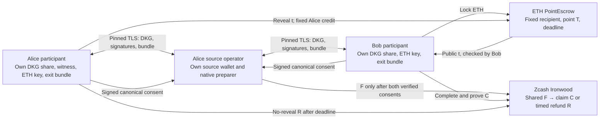

# Zatomic architecture

Alice exchanges native shielded ZEC for Bob's ETH. The exchanged ZEC stays in
Ironwood. A point-lock ETH escrow verifies the scalar that completes a prepared
RedPallas native spend signature.

This is P2P OTC settlement: assets stay on their native chains and ownership
changes between Alice and Bob. There is no wrapped token or bridge minting.
The [OTC quote](protocol.md) pins both amounts and owner identities before
native preparation. It does not replace the final full transaction consent.

The diagram separates secrets and authorities; it does not imply independently
administered hosts have been demonstrated. The source operator is Alice-owned
and privileged over her source wallet. Native preparation knows shared proving
data and can correlate the trade, but does not hold both DKG spending shares or
either participant's ETH key. The native-only TLS service cannot send ETH or
read out Alice's witness. ETH and native recovery commands are invoked locally
by the owning participant.

`PointEscrow` verifies `tG=T` on the exact RedPallas SpendAuth base, credits a
fixed recipient and separates withdrawal from reveal. It does not verify Zcash
headers, proofs of funding, recipient notes or chain finality. Both participants
observe the corresponding chains through explicit trusted local nodes.

F funds a fresh 2-of-2 joint note. C pays Bob's shielded recipient and R pays
Alice's shielded recipient. Their effects are authorized before F; v6 lets
the owner add current anchors, witnesses and proofs later. R additionally uses
an Alice-owned transparent auxiliary input to activate the native locktime.
That auxiliary outpoint/value is observable; ETH addresses, amounts, witness and
timing are also observable. Full-exchange anonymity is not claimed.

Detailed invariants and limits: [protocol](protocol.md), [security](security.md).
Operational boundaries and commands: [separate operators](evidence-index.md),
[owner-native recovery](evidence-index.md).
