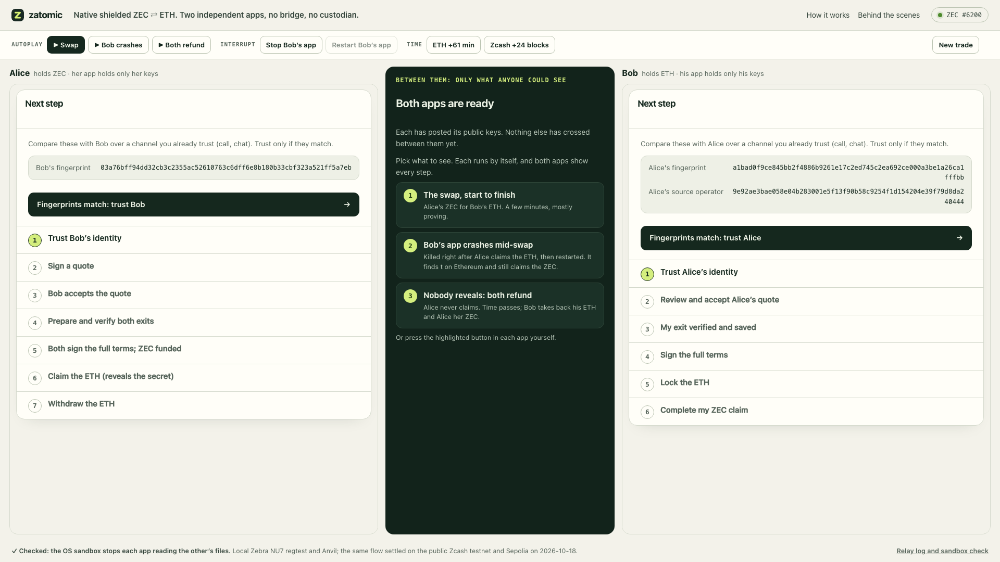
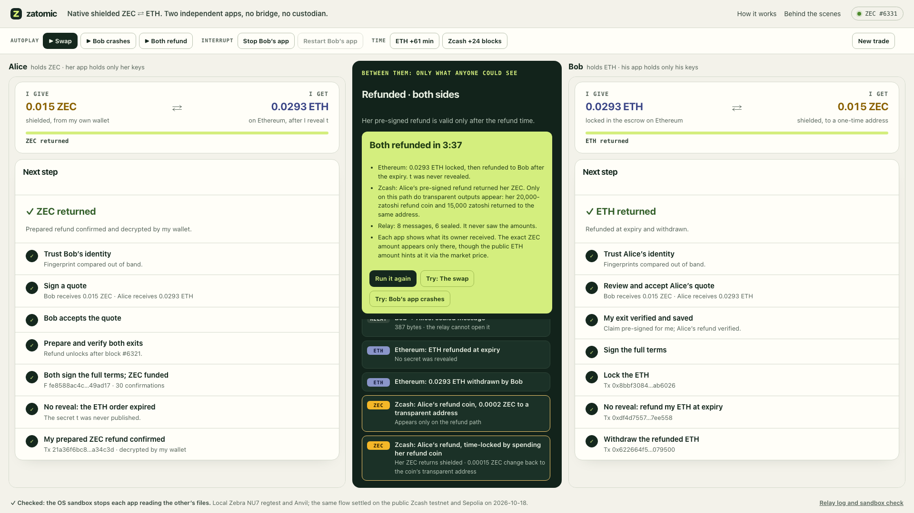

# Run the demo

The [live demo](https://162-55-186-88.sslip.io) is this two-party mode on a
rented server. You can run the same thing locally, or host your own copy
([below](#host-it-on-a-server)).

## Locally

```sh
make two-party
```

Start at **http://127.0.0.1:8790**. That one address is the whole demo:

| Page | What it is |
|---|---|
| `/` | What Zatomic does, the public testnet swap, what each observer sees, the recovery cases and the evidence records. |
| `/stage` | The live demo: both owner apps side by side, the public wire between them, and the demo controls. |
| `/network` | Behind the scenes: the chains, the sandbox check and every record the relay holds. |

The network process plays the public chains and an untrusted relay. It holds no
participant key and cannot open sealed messages. The owner apps run as separate
processes on their own ports:

| App | What it holds |
|---|---|
| **Alice** · http://127.0.0.1:8791 | Her participant keys, her secret `t`, and her own source wallet operator. |
| **Bob** · http://127.0.0.1:8792 | His participant keys only. |

Each app runs under its own macOS `sandbox-exec` policy that denies reads and
writes of the other owner's directories. At launch, the network page *proves*
this: under each app's exact policy, reading the other owner's identity file
fails with a permission error.

Native preparation (DKG and adaptor pre-signatures) runs over the existing
certificate-pinned TLS signer channel. Everything else Alice and Bob exchange
goes through the relay. A trade has eight relay messages. Only the two identity manifests travel in the clear: public keys
and ETH addresses, which appear on Ethereum anyway once the order is locked. The
other six (the signed quote, the acceptance, "signer online", the full terms,
Bob's consent and the ETH order ID) are sealed to the recipient
([how](privacy.md#sealed-relay-messages)). The network page
shows exactly what the relay sees: sender, recipient, size and time.


## The stage

Open **http://127.0.0.1:8790/stage**. It shows both real owner apps side by side
(embedded; each still holds only its own keys) and, between them, only what an
outside observer can see: relay envelopes, each Zcash transaction as its public
effects decode (number of actions, any transparent input or output), and the
escrow's events. The headline step ("Step 5 of 7 · Alice claims the ETH and
reveals t") is inferred from that public data alone. A settled swap shows two
shielded Zcash transactions and nothing transparent; the refund path shows the
auxiliary coin appearing only then. The owner apps allow framing only by this
local network page.

The stage is built for a judge on their own and for screen recording. A fresh
trade opens with three scenarios in the middle column. Each runs by itself
through the apps' own page endpoints, never touching either app's keys:

| Scenario | What it shows |
|---|---|
| **1 · The swap** | Every step to settlement: two shielded Zcash transactions, lock, claim and withdraw on Ethereum. |
| **2 · Bob's app crashes** | The same, but Bob's app is killed (SIGKILL) right after Alice's claim and restarted eight seconds later. It resumes from its own journal, reads t from Ethereum and claims the ZEC. |
| **3 · Both refund** | Alice never claims. ETH time passes, Bob refunds his ETH, the native refund matures, then A (the coin her refund needs) and her refund R appear on Zcash. |

While a scenario runs, the column shows its clock and the five-step diagram
from the landing page, lit from public events only: done, under way, still to
come, or the branch this trade did not take; Bob's lane says "stopped" while his
app is down. Below it, **Public receipts** list what the relay and both chains
recorded, each numbered with its diagram step: the relay's messages fold into
one row (open it to see each), and every Zcash and Ethereum entry gives its
block, what the node checked and its transaction ID. They follow protocol order,
since observation times on two chains do not order them reliably. At the end
the three scenarios come back above the diagram, and a **Last run** card says
how long it took, what the relay never saw and whether Bob's app recovered; the
ZEC amount appears only inside the apps. Picking a scenario after a finished run starts a fresh
trade (new keys, a new escrow order and a new shared note; the previous trade
stays on disk). A trade left part-way for 90 seconds offers Continue or Start
over. The bar above the apps has the same scenarios; **Advanced controls** opens
**Stop / Restart Bob's app**, **ETH +61 min** and **Zcash +24 blocks** (stand-ins
for time passing on a public chain) and **New trade**.

Measured on an Apple M1 with 16 GiB, each from a fresh trade: the swap took
3:32 and 3:42, Bob's app crashing 3:47, both refund 3:37, mostly proving
([record](../evidence/2026-10-18-stage-scenarios.json)).



For recording, open **/stage?record**. It hides the control bar and page links,
enlarges the narration, and is driven by keys: `1` `2` `3` scenarios, `N` new
trade, `S` / `R` stop and restart Bob's app, `E` ETH time, `Z` Zcash blocks. The
same keys work on the normal stage. The layout fits 1920×1080 and 1280×720
without scrolling.

To run this on a rented server, see [Host it on a server](#host-it-on-a-server):
each app then runs as its own Linux user, and one visitor at a time holds the
controls.

Autoplay types the agreed amounts and accepts the fingerprints shown on screen.
The amounts are 0.015 ZEC for 0.0293 ETH, or proportionally smaller once the
regtest block reward (one coinbase note funds Alice) can no longer cover that;
the reward halves every 864 blocks. A real owner compares fingerprints over a channel
they already trust.

## A trade, step by step

1. **Trust.** Each app shows the other's identity fingerprint. Compare them over
   a channel you already trust, then click *Fingerprints match*.
2. **Quote.** Alice enters exact amounts and signs. Bob's app verifies her
   signature and shows the amounts, the price and the signature status. Bob
   accepts, and his signer goes online.
3. **Prepare.** Alice funds her local source wallet (a regtest faucet). She then
   runs DKG and pre-signs both exits with Bob's signer. Each owner verifies and
   saves its own exit.
4. **Full terms.** Alice posts the agreement: escrow, amounts, expiry, refund
   height and funding transaction. Bob's client checks it and signs. Alice signs;
   her source wallet releases the ZEC funding only with both signatures.
5. **Settle.** Bob locks ETH. Alice claims it, which publishes `t`. Bob's app
   sees the claim and completes his shielded ZEC claim. Alice withdraws.


## Recovery you can show

Scenarios 2 and 3 on the stage do both of these by themselves. By hand:

- **Crash after the reveal.** After Alice claims, click *Stop Bob's app* on the
  stage (or *Kill app (SIGKILL)* on the network page), then *Restart*. Bob's app rebuilds its state from its
  own files and the chains, and offers *Claim my ZEC* again. Alice can withdraw
  meanwhile; she never needs Bob online.
- **No reveal.** Let Bob lock and Alice not claim. *ETH +61 min* stands in for
  waiting. Bob refunds and withdraws. *Zcash +24
  blocks* passes the native refund height, and Alice's prepared refund
  returns her ZEC.



## What this does and does not show

It shows that the protocol runs between two separately held sets of keys and
journals. It also shows that the relay between the owners learns only their
identities and the shape of the conversation, and that either side can stop and
resume without the other's help.

It does **not** show separate machines or administrators: everything runs on one
host and one OS account. The network is a local stand-in: it mines regtest
blocks when transactions are pending and offers labelled controls for time. Each
workspace holds one trade, so `make two-party` starts a fresh one. Recorded
results: [evidence](../evidence/2026-10-17-two-party.json).

## Host it on a server

The hosted demo is this two-party mode on one rented server,
reachable over HTTPS. Judges open one address: `/` explains the swap, `/stage`
runs a trade with both owner apps side by side, `/network` shows the relay's
records and the isolation check. Everything runs on an isolated Zcash regtest
chain and a local Anvil: no wallet, real key, public network or real value is
involved.

### What runs

| Service | Unix user | Listens on |
|---|---|---|
| `latch-zebra` | `latch-zebra` | Zebra NU7 regtest, RPC on `127.0.0.1:30342` |
| `latch-network` | `latch` | site `127.0.0.1:8790`, Anvil, relay |
| Alice's app (started by the network) | `latch-alice` | `127.0.0.1:8791`, her signer `18741` |
| Bob's app (started by the network) | `latch-bob` | `127.0.0.1:8792`, his signer `18742` |
| Caddy | `caddy` | public `:80` and `:443`, HTTPS for all three names |

The firewall opens only SSH, 80 and 443. Each owner's files live under
`/var/lib/latch/<owner>`, mode 0700 and owned by that owner's user. The other
owner's app gets a permission error there, and so does the network process. The
network proves both denials at the start of every trade, and the stage footer
shows the result. The network may start, probe and kill each app as that app's
user and nothing else ([`deploy/sudoers`](../deploy/sudoers)).

### Server

- Ubuntu 24.04 on **arm64 or x86_64**. The setup picks the matching official
  `zebrad` and Foundry builds and checks each against its pinned SHA-256.
- 4 vCPU and 8 GB RAM is enough. Avoid 4 GB. Disk: 40 GB.
- Running now on a Hetzner Cloud CPX32 (x86_64, 4 vCPU AMD EPYC Genoa, 8 GB,
  Ubuntu 24.04.4): the release Rust build took 1 minute, the whole setup about
  3 minutes, and a stage swap 1:46
  ([record](../evidence/2026-10-18-hosted-demo.json)). Arm64 hosts (Hetzner
  CAX21/CAX31 when available, netcup VPS 2000 ARM) use the same setup.
- If the provider has its own firewall (Hetzner Cloud Firewall), allow inbound
  TCP 80 and 443 as well as 22. Otherwise the certificates cannot be issued.

The site needs three names that point at the server: `HOST`, `alice.HOST` and
`bob.HOST`. Each owner app gets its own origin, so the browser keeps them apart
as well.

- Without a domain: use `HOST=<IP with dashes>.sslip.io`, for example
  `203-0-113-7.sslip.io`. `alice.203-0-113-7.sslip.io` resolves to the same IP.
- With a domain: add A records for all three names, or a wildcard.

### Set up

```sh
ssh root@SERVER_IP
git clone https://github.com/yugocabrio/zatomic /opt/latch
LATCH_HOST=203-0-113-7.sslip.io bash /opt/latch/deploy/setup.sh
```

If the repository is private, give the server a read-only deploy key or copy a
checkout to `/opt/latch` with `rsync` (the setup resets the copied files to
root ownership). [`deploy/setup.sh`](../deploy/setup.sh)
installs the packages, Rust 1.93 (from `rust-toolchain.toml`) and Foundry 1.3.1,
builds the native binary and the contract, and fetches the pinned `zebrad`,
checking its SHA-256. It then creates the four users and their private
directories, installs the sudo rule, the systemd units and the Caddy site, turns
on the firewall and starts everything. Running it again rebuilds and keeps the
chain and trades. Then open `https://HOST`. The first start activates NU7 and
prepares a trade; allow a minute or two.

### One scenario at a time

Everyone sees the same trade. Any visitor can start a scenario while none is
running; while one runs, everyone else watches it live, with the three
scenarios greyed out and a note saying why, and can start the next one as soon
as it ends. Operating the apps by hand goes to one visitor at a time: the first
press of an **Advanced controls** button hands that visitor the controls, which
let them also press the buttons inside both apps, until five minutes after
their last action. Pressing on behalf of both owners is a demo convenience: in
a real deployment each owner runs their own app on their own device.

### Chain capacity

A swap uses about 105 regtest blocks and a refund about 180: Alice's faucet
mines 101, and the refund path advances 72 more. The budget is a generous 400
per trade. The local wallet scan stops at height 10,002, so New trade is refused
when fewer than 400 blocks remain.

The faucet funds Alice with one coinbase note, and the regtest block reward
halves every 864 blocks (0.0326 ZEC from height 5,177, 0.0163 from 6,041,
0.0081 from 6,905). Demo quotes are 0.015 ZEC for 0.0293 ETH while one reward
covers that, and proportionally smaller after that, so trades keep working, just
with smaller amounts. Every day at 04:00 UTC `latch-reset.timer` checks the
height; at 6,800 or above it starts a fresh chain, before the amounts shrink. That
deletes every demo trade, all regtest data. To reset by hand:
`/usr/local/sbin/latch-reset --force`.

### Operating

```sh
systemctl status latch-network latch-zebra caddy
journalctl -u latch-network -f
cd /opt/latch && git pull && LATCH_HOST=203-0-113-7.sslip.io bash deploy/setup.sh
```

The apps' stdout and stderr go to `/var/lib/latch/net/<trade>/network/`.

### How it differs from the local demo

| | Local (`make two-party`) | Hosted |
|---|---|---|
| App separation | a macOS `sandbox-exec` policy per app | a Unix user per app; the network cannot read either |
| Zcash node | Zebra in Docker | `zebrad` as its own service; no Docker |
| Reach | loopback only | HTTPS through Caddy; the servers still bind loopback and check Host and Origin |
| Controls | anyone on the machine | one visitor at a time |

**Not claimed:** all three roles run on one machine run by one operator. This is
not independent administration, and the network process can start or stop
either app.
