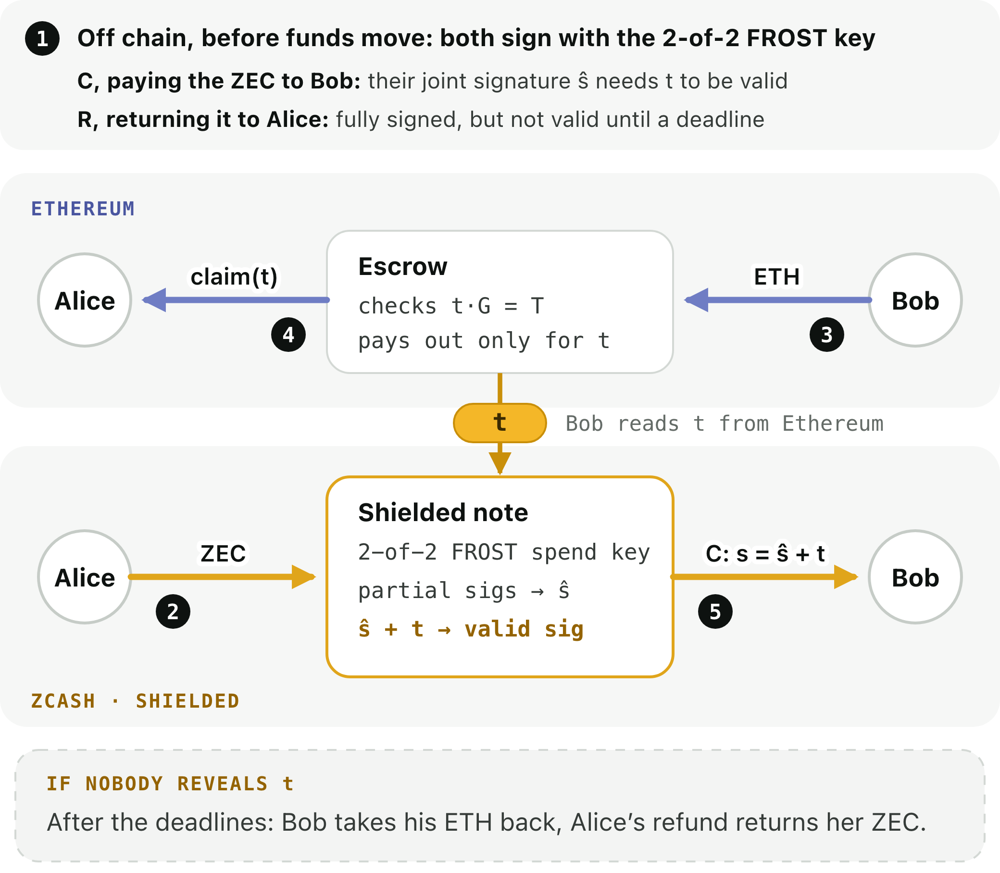

# Zatomic: atomic swaps of shielded ZEC for ETH

On the public Zcash testnet and Sepolia, funded exchanges settled on the first escrow
(2026-10-18) and on the shipped V2 escrow (2026-10-21), and funded no-reveal
trades refunded both sides on each (2026-10-20, 2026-10-21); everything else below ran on
isolated local chains and is labelled so.

## One sentence

Zatomic is an atomic swap of shielded ZEC for ETH between two people: it settles,
or each takes their own asset back, with both exits verified before funding and no
bridge, custodian or solver in between.

## What we built

Zatomic is a P2P OTC atomic-swap prototype for native Ironwood ZEC and ETH. Alice
sets exact amounts, Bob accepts her signed quote, and both approve the complete
exchange after verifying their prepared claim and refund transactions. ZEC stays
on Zcash and ETH stays on Ethereum; there is no wrapped asset or bridge minting.

The key connection is a RedPallas adaptor signature. Ethereum's immutable escrow
checks a revealed scalar against the same Pallas point used by the prepared
native claim. That scalar lets Bob complete the authorized shielded ZEC payment
without asking Alice for another signature. The EVM claim needs no Zcash
recipient address, viewing key or note opening.

Zatomic addresses the core challenges of shielded atomic swaps: joint control of
native ZEC through 2-of-2 FROST, pre-authorized claim and refund paths,
consensus-enforced refund timelocks, and adaptor-signature settlement without
revealing Zcash transaction data to Ethereum. The implementation includes
adversarial regression tests and a completed public-testnet swap.

The working demo runs actual Zebra NU7 and Anvil transactions. It shows a complete
exchange, recovery after stopping following the secret reveal, and a no-reveal
refund. In [two-party mode](two-party.md), Alice and Bob each run their own
sandboxed app that holds only their own keys. The only things passing between
them are pinned-TLS signing and a relay that sees two identity manifests and six
sealed envelopes, never the amounts or the funding transaction. Either app can be
killed and restarted mid-trade. Counterparties exchange one-time receive
addresses, never viewing keys ([what each observer sees](privacy.md)). Owner clients retain their own keys and durable recovery data. Separate
operator runs use pinned TLS and OS-enforced private-directory separation on one
host. Custom-amount exchange and refund runs check native confirmations, receiver
decryption, exact ETH withdrawals and repeat recovery without duplicate payment.

## Why Cross-chain

The product exchanges ownership across two native settlement systems. Its useful
property is that the ZEC principal and recipients stay shielded while the owners
hold prepared recovery paths. It is a focused swap, with no bridge committee,
oracle deciding the exchange outcome or custodial exchange account.

**Use case.** Two counterparties have agreed on a ZEC/ETH trade and want to
settle it directly, without depositing ZEC into a bridge, exchange or pool, and
with the Zcash payments kept shielded.

**Compared with existing routes.** Each route is good at its own job; a private
bilateral trade pays for it.

- *SPV, light-client and ZK bridges* let Ethereum verify Zcash payments and
  events, which supports general cross-chain apps. Ethereum must follow Zcash
  consensus and transaction inclusion. In Skyhook's September 2026 testnet swap
  ([post](https://forum.zcashcommunity.com/t/we-just-did-a-fully-trustless-shielded-zec-to-evm-atomic-swap-with-no-new-signing-primitives-and-yes-it-is-programmable/57827)),
  the Ethereum order carried the Zcash recipient's address (pk_d, g_d) and the
  contract checked the Zcash transaction by a txid it predicted from the
  proposal; the author plans a ZK proof to hide the receiver side
  ([October proposal](https://forum.zcashcommunity.com/t/skyhook-and-esmaste-cross-chain-bridging-messaging-and-execution-layer/58167)).
  Hiding it with ZK proofs adds proving circuits and an on-chain verifier.
- *NEAR Intents* offers competing solvers, many assets and automatic liquidity,
  and is live. Settlement runs through solvers and bridge contracts, not
  directly between the two owners. It accepts shielded ZEC and can pay ZEC out
  to an Orchard receiver ([LI.FI docs](https://docs.li.fi/introduction/zcash-ecosystem)).
  The cited Zcash bridge contract funds that payout from a transparent input, so
  the amount is public, and checks it by recovering the output with an all-zero
  outgoing viewing key
  ([code](https://github.com/Near-One/btc-bridge/blob/0b02818d47/contracts/satoshi-bridge/src/zcash_utils/orchard_policy.rs#L11-L13)).
  That key is public, so anyone can recover the payout's recipient too: a
  shielded destination alone does not make the payout private. NEAR's
  Confidential Intents hide order flow on NEAR; they are a different layer from
  the Zcash transactions compared here.
- *THORChain* integrated native ZEC in October 2026, with pool-based,
  market-priced swaps and no wrapped ZEC. THORChain says its ZEC integration
  currently uses transparent Zcash transactions
  ([THORChain](https://blog.thorchain.org/bringing-native-zcash-to-thorchain)),
  so addresses, amounts and vault movements are public, and funds pass through
  shared protocol vaults.

Zatomic needs no solver or shared liquidity pool, exposes no shielded payout
through a public viewing key, and asks Ethereum to verify no Zcash history: the
escrow checks one Pallas relation, t·G = T, and the same t completes Bob's
pre-signed shielded claim. Its two Zcash transactions on a settled swap have no
transparent input or output, and their outputs carry no outgoing viewing key:
their outgoing ciphertext cannot be used to recover them, and only each
recipient's own viewing key decrypts an output. What Zatomic leaves public is
under Honest limits: the ETH side, timing, and on a refund two small transparent
outputs (Alice's 20,000-zatoshi refund coin and its 15,000-zatoshi change). It
also gives up price discovery: it settles a price two parties already agreed.

## Demonstration and verification

- **Live demo: https://162-55-186-88.sslip.io** (hosted; regtest and a local
  Anvil, no real value). The front page explains the swap and links its
  evidence; **Try the live demo** opens both owner apps side by side with three
  one-click scenarios. One visitor drives at a time; others watch the same trade
  ([hosting](hosting.md)). Locally: `make two-party`, then
  http://127.0.0.1:8790 ([two-party mode](two-party.md)).
- [What each observer can see](privacy.md)
- [Evidence by guarantee level](evidence-index.md)
- [Exact reproduction commands](reproduce.md)
- [Protocol and transaction order](protocol.md)
- [Security reviews and assumptions](security.md)
- [Repository](https://github.com/yugocabrio/zatomic)

The browser and the CLI both use exact peer-selected amounts. Alice signs the
quote, Bob reviews and signs his acceptance, and funding is a separate approval.
There is no market feed, order book or counterparty discovery service. A local
run takes about two and a half minutes on this machine, most of it proving.
The earlier two-minute presentation is a clearly labeled edit of actual screen
checkpoints.

Logo files for the video and slides: [mark](images/zatomic-mark-1024.png)
(1024 px), [mark and wordmark on light backgrounds](images/zatomic-lockup-light.png)
and [on dark backgrounds](images/zatomic-lockup-dark.png), all with transparent
backgrounds; [SVG](images/zatomic-mark.svg). The mark is a Z inside an orbit with
two nodes: two parties, one atomic swap.

## Honest limits

One funded exchange settled on the public Zcash testnet and Sepolia on
2026-10-18 ([record](../evidence/2026-10-18-public-testnet-swap.json)): F and C
are fully shielded and the refund auxiliary was never broadcast. A funded
no-reveal trade then refunded both sides on the same networks on 2026-10-20
([record](../evidence/2026-10-20-public-testnet-refund.json)). On 2026-10-21 the
shipped V2 escrow settled a second funded swap and refunded a second no-reveal
trade under the short timing profile; the swap's first claim send failed at the
provider and was resent with the same bytes
([record](../evidence/2026-10-21-public-testnet-v2.json)). Crash recovery was exercised on isolated chains.
An internal review found and fixed a release-order flaw in the custom adaptor
signing ([security](security.md)). It is not an external audit. Independently
administered hosts have not been demonstrated. The custom adaptor composition is unaudited; the arithmetic
cross-check is not an external audit or a security proof.

The swap requires bounded monitoring, inclusion and reorg assumptions. Arbitrary
outages or source-conflicting deep forks are outside its demonstrated guarantees.
Public chain data in the funded run came from third-party RPC providers
(Tenderly and publicnode for Sepolia, testnet.zec.rocks for Zcash), not from
consensus verified by our own nodes. Ethereum gas: the shipped V2 escrow checks
t·G = T on Pallas with a precomputed comb table and keeps each order in one
storage slot. Its Sepolia receipts on 2026-10-21 were 7,100,182 gas for the
deployment with its table (once), 139,146 for the lock, 112,528 for the claim
and 43,562 for the withdrawal: 295,236 for a settled swap, against 1,420,389 on
the first escrow, whose lock alone took 799,447 because Sepolia now prices new
state high ([record](../evidence/2026-10-21-public-testnet-v2.json),
[benchmark](gas-optimization.md)).
ETH addresses, amounts, witness and timing are public. A settled swap is fully
shielded on Zcash; only a refund creates a transparent auxiliary coin, which R
spends, returning 15,000 zatoshi of change to the same address. The ZEC exchange principal remains shielded either way. This is not a claim that the entire exchange is anonymous or mainnet
ready.

## Reproducibility

Settlement code `9b978e3` passed [fresh-checkout reproduction](../evidence/2026-10-15-clean-reproduction.json).
The public testnet settlements and refunds are recorded above, with every
transaction linked.
