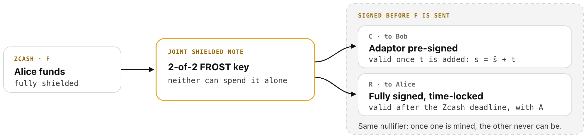
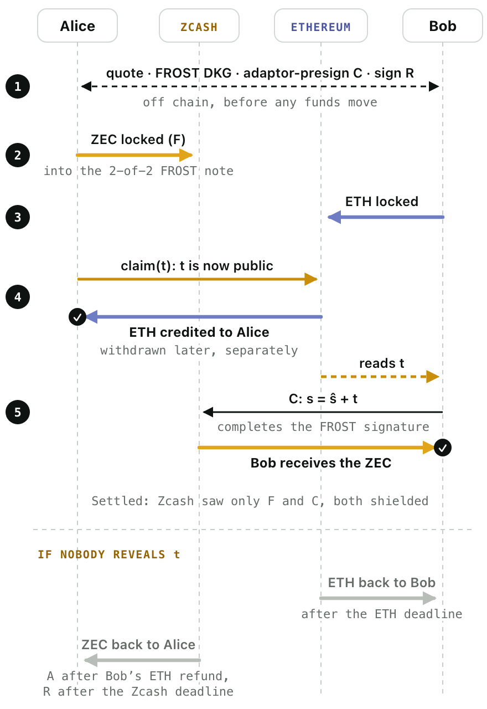
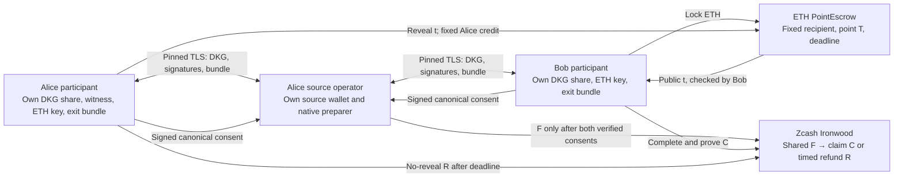

# Zatomic protocol

**Status:** settled and refunded on the public Zcash testnet and Sepolia, with the
first escrow (2026-10-18, 2026-10-20) and with the shipped V2 escrow (2026-10-21);
every transaction is in the [evidence index](evidence-index.md). Both owners ran
on one host. The adaptor extension and the Solidity Pallas check are unaudited,
and mainnet is unsupported.

## In one page

**The problem.** Alice has ZEC and wants ETH; Bob has ETH and wants ZEC. Whoever
pays first can be cheated, so the two payments must be linked. Bitcoin-style
swaps do this with hash and time locks in scripts, but a shielded Zcash note has
no scripts: it moves only with a valid spend signature from its key.

**One key, two exits.** A FROST DKG gives Alice and Bob a fresh 2-of-2 spend key.
The joint note is an ordinary Ironwood shielded note whose spend authorization key
is that FROST key, so neither can spend it alone. Before Alice funds it, both
exits from that note are prepared and checked by both sides:

| Transaction | What it does | When it can be used |
|---|---|---|
| F | Moves Alice's ZEC into the joint note; no transparent part | Alice sends it after checking both exits |
| C | Pays the joint note to Bob; adaptor pre-signed | Once t is public |
| R | Returns the joint note to Alice; fully signed | After the native refund time |
| A | Turns some of Alice's own change into a 20,000-zatoshi transparent coin that R spends | Only on the refund path |

On Ethereum, PointEscrowV2's `lock` binds the amount, Alice's fixed recipient,
the expiry and the Pallas point T. `claim(t)` credits Alice if t·G = T, `refund`
returns the ETH to Bob after the expiry, and `withdraw` pays out a credit
separately.

**Why t completes C.** A RedPallas signature (R, s) on key X and message m, with
challenge c = H(R, X, m), verifies when s·G = R + c·X. Alice picks t and shares
only T = t·G, where G is the RedPallas SpendAuth base. The two signers shift
their aggregate FROST nonce point R by T, giving R̂ = R + T, and compute their
partial signatures with the challenge c derived from R̂. The shares add up to a
pre-signature for C that is one secret short, for the randomized spend key X′:

    ŝ·G = R̂ − T + c·X′

Adding t gives s = ŝ + t, and s·G = R̂ + c·X′ is an ordinary valid signature.
Claiming the ETH publishes t, and the escrow checks t·G = T on Pallas itself, so
no cross-curve proof is needed.

In plain FROST the two partial signatures add up to a valid signature; here they
add up to ŝ, one secret short. Bob checks the pre-signature against C's sighash,
the spend key and T himself, before Alice funds anything, and Alice releases her
share only after verifying Bob's. FROST provides the joint custody; the adaptor
signature lets Bob later claim alone.

**How the two signers compute ŝ.** Each signer i holds a FROST key share xᵢ with
interpolation weight λᵢ (Σλᵢ = 1), and draws two one-use nonces dᵢ, eᵢ, publishing
Dᵢ = dᵢ·G and Eᵢ = eᵢ·G. ρᵢ is FROST's binding factor and α the randomizer Zcash
applies to the spend key. The only change from plain FROST is the nonce point
used for the challenge:

    X′ = X + α·G
    R  = Σ (Dᵢ + ρᵢ·Eᵢ)                 plain FROST nonce point
    R̂  = R + T                          shifted by the adaptor point
    c  = H(R̂ ‖ X′ ‖ sighash of C)
    ẑᵢ = dᵢ + ρᵢ·eᵢ + λᵢ·c·(xᵢ + α)     each signer's partial signature
    ŝ  = ẑ_A + ẑ_B                      so ŝ·G = R + c·X′ = R̂ − T + c·X′
    s  = ŝ + t                          once Alice's claim makes t public

Bob checks ŝ·G + T = R̂ + c·X′, which needs only T, not t. Alice, who knows t,
releases her share ẑ_A only after Bob's ẑ_B verifies against the same nonce
commitments. Otherwise Bob could shift his commitment by −T and turn Alice's share
into a valid signature without t; [security](security.md#adaptor-share-release-order)
describes that attack, its fix and the regression tests.

**Why the exits can be signed before the note exists.** In the v6 transaction
format ([ZIP 229](https://github.com/zcash/zips/blob/929a92f7383e036b6f6a48f43ec88c5bdd130003/zips/zip-0229.md#anchor-commitment-version-6)),
the anchor and the zero-knowledge proofs are authorizing data, outside the digest
that spend signatures sign. So C, R and A are signed before F is mined, checked
against a temporary tree that contains the pending note, and proved against the
real anchor afterwards without new signatures. C and R spend the same note, so
they share a nullifier: only one of them can ever be mined.

**Why the refund needs a transparent coin.** Zcash enforces a lock time only when
a transaction has a transparent input with a non-final sequence number. R
therefore also spends the coin from A, which Alice creates from her own change
only if she refunds. A settled swap puts only F and C on chain, both fully
shielded. The coin's 20,000 zatoshi is this implementation's choice, not a
consensus rule: it pays R's 5,000-zatoshi incremental fee, and R returns the
other 15,000 to Alice.

**Deadlines.** The ETH expiry comes first and the native refund time later, so
that after Alice reveals t, Bob still has time to complete C before R becomes
valid. Alice must reveal t early enough for her claim to be mined well before
the ETH expiry. Both sides watch their deadlines, and recovery assumes that
inclusion and reorgs stay within the timing window.

**Outcomes.** If t is revealed, Alice withdraws the ETH and Bob completes C, even
with Alice offline. If nobody reveals t, Bob refunds his ETH after the expiry,
and after the native refund time Alice sends A and R and gets her ZEC back,
shielded.

The rest of this document gives the construction, the components, the
transaction order, the deadlines, the recovery cases, what each observer sees,
and what the implementation checks and has tested.

## Construction

Alice sells ZEC; Bob sells ETH. Alice chooses a fresh uniform nonzero Pallas
scalar t and publishes T = t·G, with G the RedPallas SpendAuth basepoint. The EVM
escrow checks t·G = T directly. No cross-curve DLEQ, hash/scalar correspondence
proof, oracle or bridge light client is required. The cost is Pallas arithmetic
in the EVM, which has no Pallas precompile; the V2 escrow's fixed-base comb table
keeps a claim at 112,528 gas on Sepolia ([benchmarks](gas-optimization.md)).
This is a composition of existing techniques, not a claim to have invented PTLC
swaps.

Zcash funding uses a fresh 2-of-2 FROST DKG spend key. Neither party holds the
whole spending key. Both obtain shared viewing data and can prove spends. The
FROST adaptor extension is custom and unaudited; upstream FROST security does
**not** automatically establish the security of this modified protocol.

## Components

Who holds which secret, and what each part can do:

The source operator is Alice's own, privileged over her source wallet. Native
preparation knows shared proving data and can correlate the trade, but never
holds both DKG spending shares or either participant's ETH key. The native-only
TLS service cannot send ETH or read Alice's witness. Each participant runs its
own ETH and native recovery commands. The diagram separates secrets and
authorities; it does not mean independently administered hosts have been
demonstrated.

The escrow verifies t·G = T on the exact RedPallas SpendAuth base, credits a
fixed recipient and separates withdrawal from the reveal. It does not verify
Zcash headers, proofs of funding, recipient notes or chain finality. Both
participants observe the chains through nodes they explicitly trust.

## Transaction order

1. **Agree the terms.** Both networks (genesis and branch), the deployed escrow
   code and address, destinations, amounts and fees, T, both deadlines, the
   confirmation policy and a unique salt. Peers and messages are authenticated.
2. **Prepare F and both exits.** Before F can be broadcast, Alice receives a
   fully signed refund R to her shielded destination, and Bob receives and
   verifies an adaptor pre-signature for claim C to his. Both spend exactly F's
   joint note and bind every output, fee and expiry field. Until both sides
   confirm they have verified and saved their exits, the peer sees only a
   preview of F with zeroed spend and binding signatures; in v6 the preview has
   the same txid but cannot be broadcast (tested with node rejection and a
   withheld receipt).
3. **Give R a lock time that Zcash enforces.** R also spends a dedicated
   transparent coin of Alice's with a non-final sequence and nLockTime = tZ;
   without such an input Zcash ignores the lock time. At setup Alice's wallet
   signs a private transaction A that creates this 20,000-zatoshi coin from her
   own F change. R commits to A's txid (v6 txids exclude anchors and proofs), so
   A stays unbroadcast unless she refunds, and the wallet reserves that change
   note until then. The coin is never a third party's and never holds the swap
   principal; C has no transparent part. Bob's safety does not depend on A: R
   stays time-locked whatever its input. On the public path the source signer
   signs A before F, so a released F always has its refund input, and
   `public_auxiliary_execute.py` sends A only on the no-reveal path.
4. **Check both exits before F is exposed.** Both exit circuits are proved and
   verified against a temporary tree containing the pending note. Each signer
   also verifies R's shielded spend and binding signatures, A's P2PKH signature,
   C's dummy authorizations and the private data needed to re-prove later; C's
   adaptor pre-signature is verified without t. These temporary proofs are never
   broadcast; C and R are re-proved after F is mined. A pays 15,000 zatoshi in
   fees; R returns 15,000 of the 20,000-zatoshi coin after its 5,000-zatoshi
   incremental fee. Alice broadcasts F only after checking both exits. Bob waits
   for authenticated confirmation of the exact note, obtains all data needed to
   prove C, and checks that R cannot become valid too soon.
5. **Bob locks ETH.** The exact amount goes into the escrow, bound to T, Alice's
   ETH recipient, the terms digest and the expiry tE. Alice checks the exact
   contract code, state and confirmation policy, with enough time left.
6. **Alice reveals t.** She submits it before the reveal cutoff. Anyone may relay
   the claim, but it credits only Alice's fixed recipient. Withdrawal is a
   separate call, so a recipient contract that rejects ETH cannot revert a valid
   claim.
7. **Bob completes C.** He reads t from the claim's calldata or event, checks it
   against T, adds it to the FROST pre-signature ŝ to complete C's signature
   (s = ŝ + t), proves and broadcasts C, and rebroadcasts or re-anchors until
   it confirms.

C and R have no expiry within the swap horizon; a swap that would cross a network
upgrade must be refused. Signing before F is mined relies on v6 signatures not
covering anchors, witnesses or proofs; the isolated-chain tests exercise exactly
that, with no-expiry v6 claim and refund transactions.

## Deadlines

The escrow expires at tE and R becomes valid at tZ; on the public path both are
timestamps, and Zebra compares tZ with the block's own timestamp (the local
demo uses block heights instead, and heights are never converted into times).
The refund must open late enough that Bob can still finish C after seeing t:

    tZ − κZ > tE + ΔO + ΔZ

where κZ bounds how early a Zcash block timestamp may run, ΔO is Bob's time to
observe t, and ΔZ his time to prove, include and confirm C. Alice reveals t only
while her claim can still be mined before tE.

[`scripts/timestamp_policy.py`](../scripts/timestamp_policy.py) checks this for
every plan with fixed, reviewed bounds:

| Bound | Value |
|---|---|
| Clock error, each side | 60 s |
| Early Zcash block timestamp (κZ) | 7,200 s |
| Bob observes t, proves, includes, confirms and survives a reorg (ΔO + ΔZ) | 9,900 s |
| Reveal cutoff before tE (must exceed 3,120 s of clock error, ETH inclusion, settlement and retry) | 3,600 s |
| Funding cutoff before tE | 7,200 s |

| Profile | tE after the plan | tZ after tE | Used |
|---|---|---|---|
| default | 6 h | 24 h | public runs of 2026-10-18 and 10-20 |
| short (each owner opts in) | 3 h | 6 h | public runs of 2026-10-21 |

These bounds are operator assumptions, not guarantees. Deployed-network policy
must also account for node lag, fees, confirmation depth and upgrades.
[`scripts/check_swap_model.py`](../scripts/check_swap_model.py) reproduces theft
when the refund lock is ineffective or the gap too short; this finite model is
not a complete security proof.

## Recovery

| Stop/failure | Result under the stated assumptions |
|---|---|
| Either party refuses setup | No protocol funding should have occurred |
| Alice funds, Bob does not lock ETH | Alice broadcasts R after tZ |
| Bob locks, Alice never reveals | Bob refunds ETH at tE; Alice refunds ZEC after tZ |
| Alice stops after a valid timely ETH claim is sent | Bob observes t and completes C; Alice's ETH is credited |
| Bob stops after locking ETH | Safe only if Bob resumes/uses a relay before the Zcash recovery window ends |
| Bob sees t in a failed/late EVM transaction | t cannot be made secret again; Alice must enforce cutoff and valid-call checks |
| Reorg/censorship exceeds configured bounds | Safety is not guaranteed by this bounded-timelock construction |

This is a monitored atomic-swap design, not indefinite offline safety. The honest
party needs bounded observation/inclusion latency and sufficient fee reserves.
Confirmations reduce reorg risk; they do not make PoW finality mathematical.

## Visibility

- Zcash observers: normal shielded funding/claim metadata, no public principal
  or shielded address. Only a refund exposes the auxiliary transaction A (a
  20,000-zatoshi transparent output from Alice's change) and links it to R,
  which returns 15,000 zatoshi to the same transparent address.
- EVM observers: ETH amount, maker/recipient, T, t after reveal, deadlines,
  terms commitment and timing. ETH-side privacy is not claimed.
- Counterparty: agreed amounts, the peer's one-time receive **address** (never
  its viewing key, since 2026-10-17), and shared-note viewing/proving data. The
  one-time DKG prevents viewing unrelated swaps. Observer by observer:
  [privacy](privacy.md).
- Local fixture runner: both clients' synthetic secrets on one host; not evidence
  of independent operators or production secret isolation.

## Implementation and test status

What the code checks around the protocol, and how far each part has been tested.
"Isolated" means local Zebra and Anvil chains; "public" means the Zcash testnet
and Sepolia. Each item's evidence is in the [evidence index](evidence-index.md),
and the public commands are in [public execution](public-execution.md).

**Public runs.** Settled on 2026-10-18
([record](../evidence/2026-10-18-public-testnet-swap.json)) and refunded on
2026-10-20 ([record](../evidence/2026-10-20-public-testnet-refund.json)) with the
first escrow; settled and refunded again on 2026-10-21 with the shipped V2 escrow
([record](../evidence/2026-10-21-public-testnet-v2.json)). Both owners ran on one
host.

**Quote and setup**
- Alice signs an exact-amount quote and Bob signs his acceptance; each pins it
  before preparing C and R. The quote authorizes preparation only: contract,
  salt, deadlines and the exact funding graph still need the final consent,
  which both owners sign over the full cross-chain agreement.
- On the public path, pinned identity keys sign the quote, the authenticated DKG
  messages and the destination receipts, and the unsigned graph is checked
  against them. Each owner verifies a graph packet with the source wallet's
  details removed, presigns C and R with its own DKG share, and saves the exact
  exits before signing receipts. These exports verify without the original
  directories.
- A conditional agreement binds the native graph, the clock, gas and
  confirmation policy and the intended escrow code; both owners sign it in a
  separate consent domain. These approvals are distinct from consent to any
  single transaction.

**Funding (F)**
- The source wallet requires owner pins bound to its actual keys and journals
  its release decision under an OS lock, so cancellation and release are
  mutually exclusive: an unreleased setup can be cancelled for good, and any
  release or pending intent forbids cancellation.
- Source preparation joins a confirmed historical witness to the current
  unspent notes and reserves the note and A's coin. A reservation's age never
  proves an earlier signature is dead, so nothing is released automatically.
  New offers take the source witness six blocks below the tip (an
  isolated-chain parameter, not a finality guarantee), and the wallet rejects an
  orphaned anchor before signing.
- A read-only preflight checks the consents, rejects synthetic inputs before
  any network access, checks the escrow's code, order state and gas reserves,
  and requires 12 confirmations of F before lock and reveal. It never releases
  anything.
- The source signer re-checks the reserved note, nullifier, viewing key and
  anchor against the unsigned F, writes its intent before signing, and on
  restart reuses the exact signed bytes, proofs and anchor.

**Watching and recovery**
- Each owner can export its accepted bundle into a watch-only workspace with
  viewing and proving data but no spending key, and re-prove its exit there.
- Readers check the exact exit on Zcash and the exact order on Ethereum, keep
  earlier observations across failed reads and reorg reports, and extract t
  from a pending or mined claim or from the escrow's events. t is accepted only
  after the adaptor equation checks, independent of ETH finality.
- A foreground monitor polls known hashes, catches up on events and journals
  what it has covered. It trusts the RPC provider: it does not see every
  mempool, has no latency guarantee and needs an operator watching it.
- The recovery decision prefers native settlement, lets an authorized Bob claim
  without reading Ethereum, and lets Alice refund only if she never exposed t,
  the escrow order is terminal or empty, R's time has passed and A's coin is
  the exact one agreed.

**Sending**
- Every send is explicit: by default the commands only check, and broadcasting
  needs the testnet flag. Each owner journals its decision and the exact signed
  bytes before sending, so a restart resends the same bytes instead of signing
  again.
- ETH actions use the agreed gas ceiling, with no automatic fee or nonce
  replacement. Receipts are reconciled against the exact signed effects, the
  canonical block and the expected event; withdrawal goes to a fixed owner
  address.

**Tested on isolated chains**
- Settlement and refund: C and R pre-signed before funding, R rejected before
  its time, C completed from an actual EVM claim, and R rejected after C.
- Separate signer processes with persisted nonce-attempt replay protection.
  Each participant checks its own receiver, funding output, payout, fees,
  refund time and signature domain before contributing.
- Crashes: SIGKILL after a send, lost checkpoints, and process guardians that
  clean up prover, node and signer workers.
- Mempool: a competing relayer's claim succeeds while Alice's own transaction
  reverts, and settlement still follows the canonical event.
- Forks: Anvil forks that remove, replay or replace a claim; Zebra block
  invalidation of F and of the exits, which are re-proved from the bundle with
  the same v6 txid while recipients decrypt the same payout and ETH withdrawals
  are not repeated; replay of an orphaned F after a verified ETH claim.
- A TLS link between coordinator and signers that rejects wrong credentials,
  roles and replays after disconnect. It authenticates the connection, not
  chain state.

**Still open**
- Independent operators: both owners have run on one host; independently
  operated source wallets and remote owner clients are unfinished.
- Public-network reorgs, mempool completeness and timing are assumptions, not
  tested guarantees.
- Not exercised: source re-proving, conflicting source spends, coordinated
  recovery when both settlements are missing, a refund winning beyond the
  allowed window, and arbitrary crash points.

## References

- [ZIP 229](https://github.com/zcash/zips/blob/929a92f7383e036b6f6a48f43ec88c5bdd130003/zips/zip-0229.md#anchor-commitment-version-6): v6 anchors and proofs are authorizing data, outside what spend signatures sign.
- [ZIP 374](https://zips.z.cash/zip-0374): PCZT, the format for passing partly built transactions between signers.
- [ZIP 312](https://zips.z.cash/zip-0312): rerandomized FROST.
- [Zebra accessor](https://github.com/ZcashFoundation/zebra/blob/6cc6d360e51fe07e661c26f02230e06d81b468c7/zebra-chain/src/transaction.rs#L128): non-final transparent input required.
- [Zebra check](https://github.com/ZcashFoundation/zebra/blob/6cc6d360e51fe07e661c26f02230e06d81b468c7/zebra-consensus/src/transaction/check.rs#L71): strict block time/height comparison.
- [ASMR recovery](https://github.com/MerosCrypto/asmr/blob/f7623dda07d052835acb35ff11338e1d98d93f97/src/tests/swap/client/funded_get_scripted.rs): different BTC/Sapling construction with counter-asset recovery. Read, not executed/imported.
- [RFC 9591](https://www.rfc-editor.org/rfc/rfc9591.html): FROST, not a proof for our extension.
- [EFD](https://www.hyperelliptic.org/EFD/g1p/auto-shortw-jacobian-0.html): formulas checked against pasta_curves vectors.
