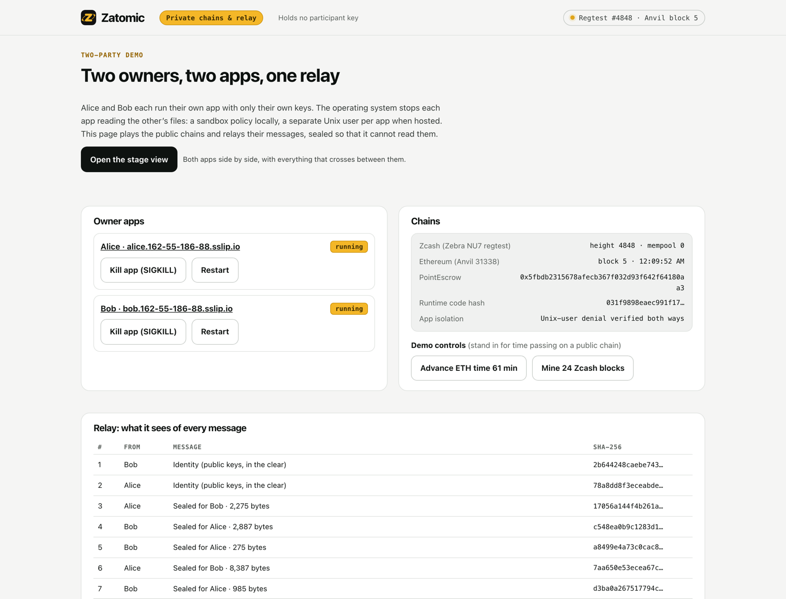
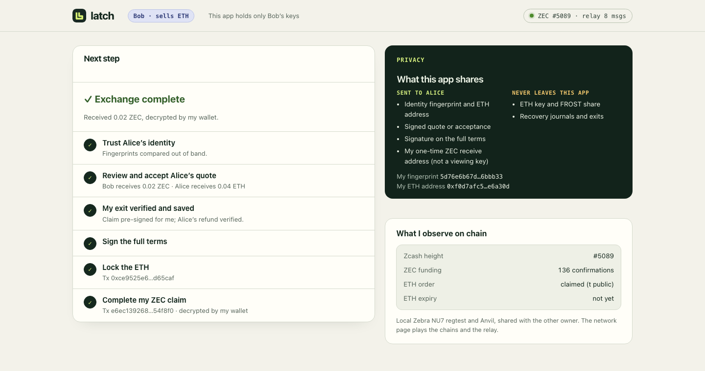
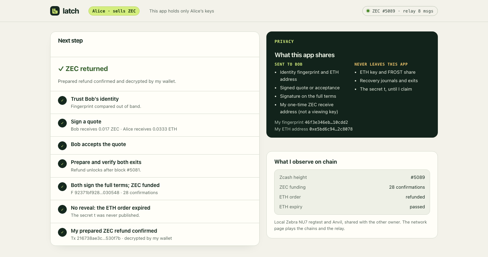

# Two-party mode: each owner runs their own app

```sh
make two-party
```

Start at **http://127.0.0.1:8790**. That one address is the whole demo:

| Page | What it is |
|---|---|
| `/` | What Zatomic does, the public testnet swap, what each observer sees, the recovery cases and the evidence records. |
| `/stage` | The live demo: both owner apps side by side, the public wire between them, and the demo controls. |
| `/network` | Behind the scenes: the chains, the sandbox check and every record the relay holds. |

The network process plays the public chains and an untrusted relay. It holds no
participant key and cannot open sealed messages. The owner apps run as separate
processes on their own ports:

| App | What it holds |
|---|---|
| **Alice** · http://127.0.0.1:8791 | Her participant keys, her secret `t`, and her own source wallet operator. |
| **Bob** · http://127.0.0.1:8792 | His participant keys only. |

Each app runs under its own macOS `sandbox-exec` policy that denies reads and
writes of the other owner's directories. At launch, the network page *proves*
this: under each app's exact policy, reading the other owner's identity file
fails with a permission error. Native preparation (DKG and adaptor
pre-signatures) runs over the existing certificate-pinned TLS signer channel.
Everything else Alice and Bob exchange goes through the relay. A trade has eight
relay messages. Only the two identity manifests travel in the clear: public keys
and ETH addresses, which appear on Ethereum anyway once the order is locked. The
other six (the signed quote, the acceptance, "signer online", the full terms,
Bob's consent and the ETH order ID) are sealed to the recipient. The network page
shows exactly what the relay sees: sender, recipient, size and time.



## Sealed relay messages

Each owner has a dedicated secp256k1 relay key, separate from its ETH key. Its
public half is in the identity manifest, so the fingerprint both owners compare
also pins it. For each message the sender draws an ephemeral key. The message key
is SHA-256 over a header (direction, ephemeral key, both relay keys) and two
ECDH secrets: ephemeral–recipient and sender–recipient. The body and its topic
are encrypted with ChaCha20-Poly1305, with the header as associated data
([`relay_envelope.rs`](../crates/swap-native/src/relay_envelope.rs)).

- Only the recipient can open a message, and only the pinned sender (or the
  recipient) can produce one that opens. A later leak of the sender's relay key
  does not open earlier messages.
- The relay can drop, delay or replay a message, but cannot read or alter one.
  Each app opens only its pinned peer's envelopes and ignores anything else.
- Order and size still show which step a message is, and when it was sent.

Before this change (2026-10-17) the six messages travelled in the clear. Anyone
running the relay could read the ZEC amount, the funding txid and the joint note
commitment, and so pick out the swap's Zcash transactions.
`scripts/check_relay_privacy.py` fails on such a workspace and passes on a new
one: it requires every record to be an identity or a sealed envelope, and finds
none of the trade's private values (funding txid, note commitment, auxiliary
txid, receive addresses, ETH salt, quote ID) in the relay's files.

## Stage view (for a live demo or a video)

Open **http://127.0.0.1:8790/stage**. It shows both real owner apps side by side
(embedded; each still holds only its own keys) and, between them, only what an
outside observer can see: relay envelopes, each Zcash transaction as its public
effects decode (number of actions, any transparent input or output), and the
escrow's events. The headline step ("Step 5 of 7 · Alice claims the ETH and
reveals t") is inferred from that public data alone. A settled swap shows two
shielded Zcash transactions and nothing transparent; the refund path shows the
auxiliary coin appearing only then. The owner apps allow framing only by this
local network page.

The stage is built for a judge on their own and for screen recording. A fresh
trade opens with three scenarios in the middle column. Each runs by itself
through the apps' own page endpoints, never touching either app's keys:

| Scenario | What it shows |
|---|---|
| **1 · The swap** | Every step to settlement: two shielded Zcash transactions, lock, claim and withdraw on Ethereum. |
| **2 · Bob's app crashes** | The same, but Bob's app is killed (SIGKILL) right after Alice's claim and restarted eight seconds later. It resumes from its own journal, reads t from Ethereum and claims the ZEC. |
| **3 · Both refund** | Alice never claims. ETH time passes, Bob refunds his ETH, the native refund matures, then Alice's refund coin and her refund appear on Zcash. |

While a scenario runs, the column shows its clock. At the end a result card sums
up what each chain and the relay showed, from public data only; the ZEC amount
appears only inside the apps. **Run it again** and **Try:** buttons start a fresh
trade (new keys, a new escrow order and a new shared note; the previous trade
stays on disk). A trade left part-way for 90 seconds offers Continue or Start
over. The bar above the apps has the same scenarios, plus **Stop / Restart Bob's
app**, **ETH +61 min** and **Zcash +24 blocks** (stand-ins for time passing on a
public chain) and **New trade**.

For recording, open **/stage?record**. It hides the control bar and page links,
enlarges the narration, and is driven by keys: `1` `2` `3` scenarios, `N` new
trade, `S` / `R` stop and restart Bob's app, `E` ETH time, `Z` Zcash blocks. The
same keys work on the normal stage. The layout fits 1920×1080 and 1280×720
without scrolling.

To run this for judges on a rented server, see [hosting](hosting.md): each app
then runs as its own Linux user, and one visitor at a time holds the controls.

Autoplay types the agreed amounts (0.019 ZEC for 0.0371 ETH) and accepts the
fingerprints shown on screen. A real owner compares fingerprints over a channel
they already trust.

## A trade, step by step

1. **Trust.** Each app shows the other's identity fingerprint. Compare them over
   a channel you already trust, then click *Fingerprints match*.
2. **Quote.** Alice enters exact amounts and signs. Bob's app verifies her
   signature and shows the amounts, the price and the signature status. Bob
   accepts, and his signer goes online.
3. **Prepare.** Alice funds her local source wallet (a regtest faucet). She then
   runs DKG and pre-signs both exits with Bob's signer. Each owner verifies and
   saves its own exit.
4. **Full terms.** Alice posts the agreement: escrow, amounts, expiry, refund
   height and funding transaction. Bob's client checks it and signs. Alice signs;
   her source wallet releases the ZEC funding only with both signatures.
5. **Settle.** Bob locks ETH. Alice claims it, which publishes `t`. Bob's app
   sees the claim and completes his shielded ZEC claim. Alice withdraws.



## Recovery that you can show

- **Crash after the reveal.** After Alice claims, click *Kill app (SIGKILL)* for
  Bob on the network page, then *Start*. Bob's app rebuilds its state from its
  own files and the chains, and offers *Claim my ZEC* again. Alice can withdraw
  meanwhile; she never needs Bob online.
- **No reveal.** Let Bob lock and Alice not claim. The network page's *Advance
  ETH time 61 min* stands in for waiting. Bob refunds and withdraws. *Mine 24
  Zcash blocks* passes the native refund height, and Alice's prepared refund
  returns her ZEC.



## What this does and does not show

It shows that the protocol runs between two separately held sets of keys and
journals. It also shows that the relay between the owners learns only their
identities and the shape of the conversation, and that either side can stop and
resume without the other's help.

It does **not** show separate machines or administrators: everything runs on one
host and one OS account. The network is a local stand-in: it mines regtest
blocks when transactions are pending and offers labelled controls for time. Each
workspace holds one trade, so `make two-party` starts a fresh one. Recorded
results: [evidence](../evidence/2026-10-17-two-party.json).
